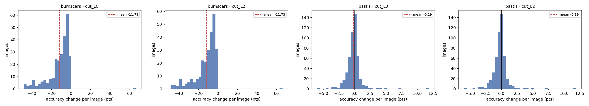
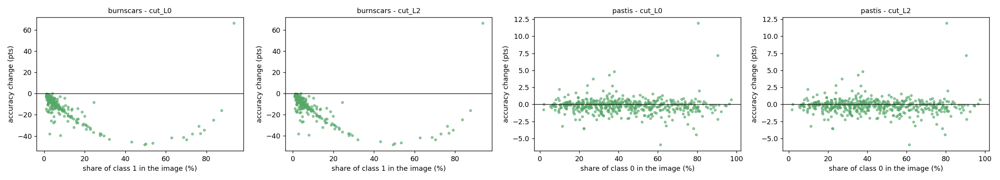
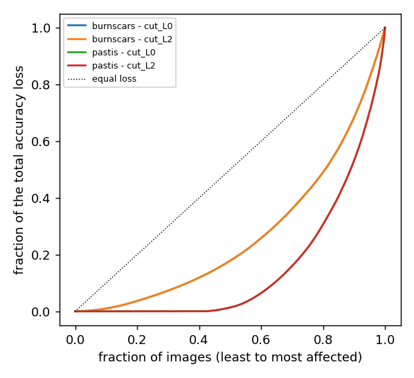

# Per-image ablation analysis

| dataset | condition | images | mean ± std (acc, pts) | unaffected | top-10% share | Gini | verdict |
|---|---|---|---|---|---|---|---|
| burnscars | cut_L0 | 264 | -11.73 ± 11.87 | 2% | 31% | 0.46 | MIXED |
| burnscars | cut_L2 | 264 | -11.73 ± 11.87 | 2% | 31% | 0.46 | MIXED |
| pastis | cut_L0 | 496 | -0.19 ± 1.16 | 54% | 47% | 0.70 | MIXED |
| pastis | cut_L2 | 496 | -0.19 ± 1.16 | 54% | 47% | 0.70 | MIXED |

## burnscars — cut_L0 (264 images)

- **accuracy change (pts):** -11.73 ± 11.87 (95% CI -13.10 … -10.34) | median -8.20 | 5/25/75/95%: -37.82 -14.88 -4.36 -1.29
- **mIoU change (pts):** -43.38 ± 12.27 (95% CI -44.84 … -41.87) | median -46.66 | 5/25/75/95%: -57.94 -50.62 -39.41 -17.37
- **pixels changed (%):** +13.75 ± 12.58 (95% CI +12.29 … +15.30) | median +9.18 | 5/25/75/95%: +2.13 +4.95 +17.17 +40.94
- **spread:** 1.5% unaffected (|change| < 0.5 pt), 90.5% lose > 2 pts, 43.6% lose > 10 pts; the 10% most affected carry 31.3% of the loss; Gini 0.46; coefficient of variation 1.01

| correlate | Pearson r | Spearman ρ |
|---|---|---|
| share_class0 | +0.49 | +0.79 |
| share_class1 | -0.49 | -0.79 |
| acc_base | -0.24 | +0.40 |

Accuracy change by share of class 1:

| share bin | images | mean change | std |
|---|---|---|---|
| 0.9-2.2% | 66 | -4.29 | 3.91 |
| 2.2-3.8% | 66 | -7.16 | 5.52 |
| 3.8-7.9% | 66 | -10.72 | 4.92 |
| 7.9-93.6% | 66 | -24.75 | 15.80 |

**Verdict:** MIXED: the dependence varies but is spread over many images; inspect the correlations and bins to see what drives it

## burnscars — cut_L2 (264 images)

- **accuracy change (pts):** -11.73 ± 11.87 (95% CI -13.11 … -10.33) | median -8.22 | 5/25/75/95%: -38.07 -14.92 -4.35 -1.28
- **mIoU change (pts):** -43.38 ± 12.27 (95% CI -44.84 … -41.87) | median -46.68 | 5/25/75/95%: -57.94 -50.50 -39.38 -17.22
- **pixels changed (%):** +13.75 ± 12.58 (95% CI +12.28 … +15.30) | median +9.19 | 5/25/75/95%: +2.15 +4.93 +17.16 +40.94
- **spread:** 1.5% unaffected (|change| < 0.5 pt), 90.9% lose > 2 pts, 43.9% lose > 10 pts; the 10% most affected carry 31.3% of the loss; Gini 0.46; coefficient of variation 1.01

| correlate | Pearson r | Spearman ρ |
|---|---|---|
| share_class0 | +0.49 | +0.79 |
| share_class1 | -0.49 | -0.79 |
| acc_base | -0.24 | +0.40 |

Accuracy change by share of class 1:

| share bin | images | mean change | std |
|---|---|---|---|
| 0.9-2.2% | 66 | -4.30 | 3.91 |
| 2.2-3.8% | 66 | -7.17 | 5.54 |
| 3.8-7.9% | 66 | -10.72 | 4.90 |
| 7.9-93.6% | 66 | -24.76 | 15.80 |

**Verdict:** MIXED: the dependence varies but is spread over many images; inspect the correlations and bins to see what drives it

## pastis — cut_L0 (496 images)

- **accuracy change (pts):** -0.19 ± 1.16 (95% CI -0.29 … -0.09) | median -0.12 | 5/25/75/95%: -1.78 -0.62 +0.24 +1.07
- **mIoU change (pts):** +0.07 ± 4.11 (95% CI -0.29 … +0.44) | median +0.01 | 5/25/75/95%: -5.10 -0.94 +1.10 +5.07
- **pixels changed (%):** +3.33 ± 2.00 (95% CI +3.15 … +3.50) | median +3.03 | 5/25/75/95%: +0.88 +1.89 +4.13 +7.03
- **spread:** 54.4% unaffected (|change| < 0.5 pt), 4.0% lose > 2 pts, 0.0% lose > 10 pts; the 10% most affected carry 46.5% of the loss; Gini 0.70; coefficient of variation 6.02

| correlate | Pearson r | Spearman ρ |
|---|---|---|
| share_class0 | -0.03 | -0.08 |
| share_class1 | +0.02 | +0.06 |
| share_class2 | -0.02 | +0.01 |
| share_class3 | +0.06 | +0.07 |
| share_class4 | -0.00 | -0.01 |
| share_class5 | -0.01 | -0.01 |
| share_class6 | -0.09 | -0.06 |
| share_class7 | -0.01 | -0.01 |
| share_class8 | +0.02 | -0.04 |
| share_class9 | -0.02 | -0.03 |
| share_class10 | +0.06 | +0.09 |
| share_class11 | +0.01 | -0.05 |
| share_class12 | -0.08 | -0.14 |
| share_class13 | -0.06 | -0.09 |
| share_class14 | +0.11 | +0.04 |
| share_class15 | -0.05 | +0.04 |
| share_class16 | -0.07 | -0.10 |
| share_class17 | -0.01 | +0.03 |
| share_class18 | +0.07 | +0.07 |
| acc_base | -0.13 | -0.01 |

Accuracy change by share of class 0:

| share bin | images | mean change | std |
|---|---|---|---|
| 1.8-25.3% | 124 | -0.19 | 0.89 |
| 25.3-40.1% | 124 | -0.04 | 1.07 |
| 40.1-59.9% | 124 | -0.24 | 0.79 |
| 59.9-97.3% | 124 | -0.29 | 1.67 |

**Verdict:** MIXED: the dependence varies but is spread over many images; inspect the correlations and bins to see what drives it

## pastis — cut_L2 (496 images)

- **accuracy change (pts):** -0.19 ± 1.16 (95% CI -0.29 … -0.09) | median -0.12 | 5/25/75/95%: -1.78 -0.62 +0.24 +1.07
- **mIoU change (pts):** +0.07 ± 4.11 (95% CI -0.29 … +0.44) | median +0.01 | 5/25/75/95%: -5.10 -0.94 +1.10 +5.07
- **pixels changed (%):** +3.33 ± 2.00 (95% CI +3.15 … +3.50) | median +3.03 | 5/25/75/95%: +0.88 +1.89 +4.13 +7.03
- **spread:** 54.4% unaffected (|change| < 0.5 pt), 4.0% lose > 2 pts, 0.0% lose > 10 pts; the 10% most affected carry 46.5% of the loss; Gini 0.70; coefficient of variation 6.02

| correlate | Pearson r | Spearman ρ |
|---|---|---|
| share_class0 | -0.03 | -0.08 |
| share_class1 | +0.02 | +0.06 |
| share_class2 | -0.02 | +0.01 |
| share_class3 | +0.06 | +0.07 |
| share_class4 | -0.00 | -0.01 |
| share_class5 | -0.01 | -0.01 |
| share_class6 | -0.09 | -0.06 |
| share_class7 | -0.01 | -0.01 |
| share_class8 | +0.02 | -0.04 |
| share_class9 | -0.02 | -0.03 |
| share_class10 | +0.06 | +0.09 |
| share_class11 | +0.01 | -0.05 |
| share_class12 | -0.08 | -0.14 |
| share_class13 | -0.06 | -0.09 |
| share_class14 | +0.11 | +0.04 |
| share_class15 | -0.05 | +0.04 |
| share_class16 | -0.07 | -0.10 |
| share_class17 | -0.01 | +0.03 |
| share_class18 | +0.07 | +0.07 |
| acc_base | -0.13 | -0.01 |

Accuracy change by share of class 0:

| share bin | images | mean change | std |
|---|---|---|---|
| 1.8-25.3% | 124 | -0.19 | 0.89 |
| 25.3-40.1% | 124 | -0.04 | 1.07 |
| 40.1-59.9% | 124 | -0.24 | 0.79 |
| 59.9-97.3% | 124 | -0.29 | 1.67 |

**Verdict:** MIXED: the dependence varies but is spread over many images; inspect the correlations and bins to see what drives it

## Figures

